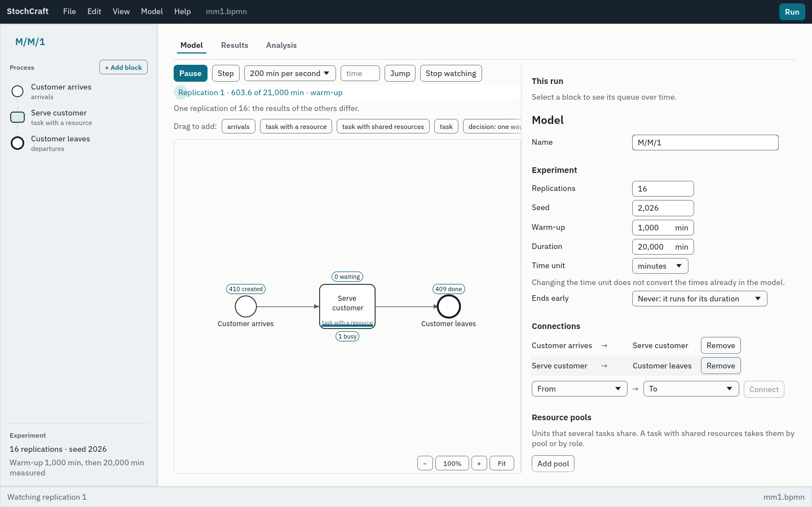
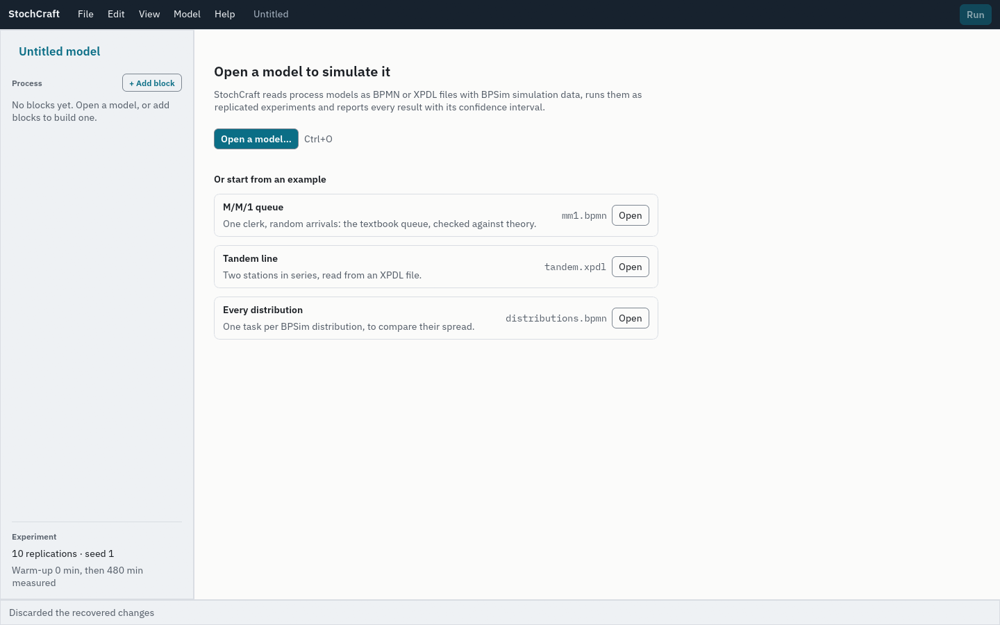
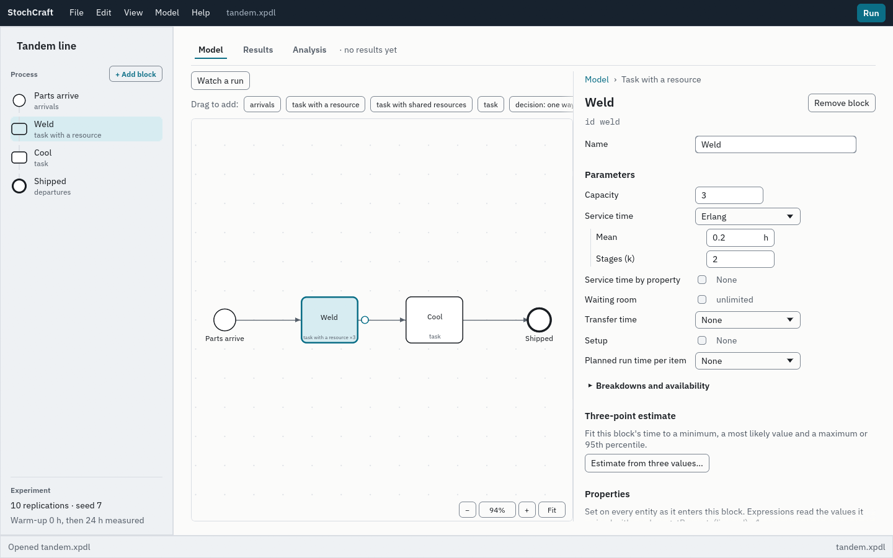
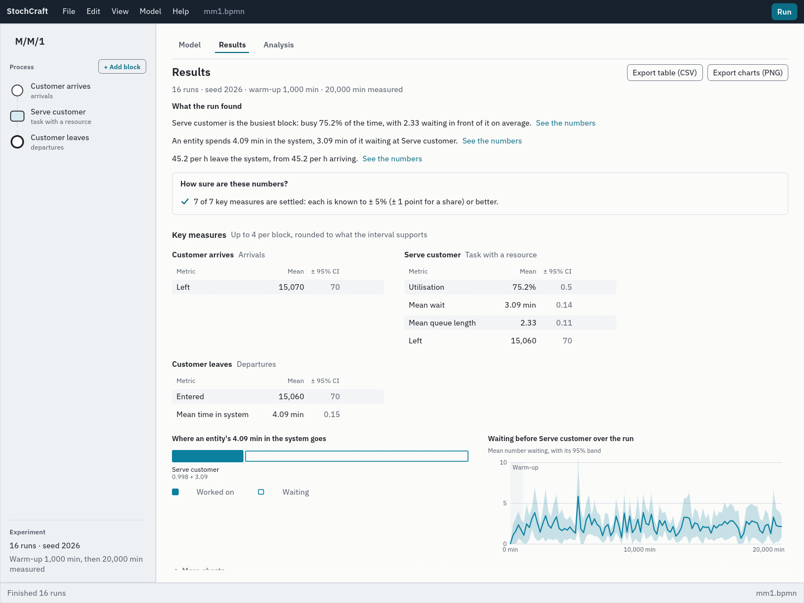

# StochCraft

**Draw how work flows through your factory, warehouse, clinic or service. StochCraft runs it many
times with random delays and tells you where the waiting is, how busy each step is, and how sure
those numbers are.**

[Try it](https://helenkwok.github.io/StochCraft/) · [Install](docs/installation.md) ·
[User guide](docs/user-guide.md) · [Developers](docs/developers.md) · [Roadmap](ROADMAP.md)

StochCraft is a discrete-event simulation tool: free, open source and written in Rust. It runs in
your browser or as a desktop app on Windows, macOS and Linux. Nothing needs an account or a
server; your models stay on your computer.

## Try it

Open [helenkwok.github.io/StochCraft](https://helenkwok.github.io/StochCraft/) and pick an
example. The browser app works offline once loaded, and your browser can install it like an app.

To run it on your desktop, download it from the
[releases page](https://github.com/helenkwok/StochCraft/releases) (Windows, macOS and Linux), or
build it from source; see the [installation guide](docs/installation.md).

## How it works

|  |  |  |
| :---: | :---: | :---: |
| **1. Open an example or a model file**, or start a new one | **2. Draw the flow** and set each step's times, capacity, breakdowns and shifts | **3. Run** and read each result with its 95% confidence interval |

## What it does

| In the window | Also |
| --- | --- |
| Draw the flow: arrivals, tasks, decisions, splits and joins, batches, departures | Open and save BPMN and XPDL files with BPSim data, the open standards other process tools use |
| Times as distributions, with a three-point estimate when you only know a minimum, a likely value and a maximum | A [command line](docs/developers.md#the-command-line) for scripted and batch runs, with CSV and JSON output |
| Capacity, waiting-room limits, shared resource pools (with a service time for each pool, for servers that differ in speed), breakdowns, shifts and setups | An [MCP server](docs/mcp.md), so an AI agent can build, run and compare models |
| Many runs in parallel, each result with its 95% confidence interval, or as many runs as the results need to be precise enough | Checked against queueing theory and published results ([details](docs/developers.md#how-it-is-checked)) |
| Watch one run move through the model, step by step | Undo and redo for every change |
| Sweep a parameter, rank parameters by sensitivity, size capacity to a target | The interface in English and 44 other languages |
| Lean measures: OEE, takt and cycle time, time in each state | Light, dark and custom themes |
| Conveyors with a length and a speed, accumulating or not | A capacity table before any run: each station's load and status, the bottleneck, and the mean wait where a queueing formula holds |
| A 3D view and a to-scale Layout view of the model, and a dashboard beside it | |
| Export the results table as CSV and the charts as PNG | Check a run against observed data: an observed value differs, or agrees within a tolerance, and a bound passes, fails or is inconclusive, by the 95% interval |
| Monte Carlo models: uncertain inputs, outputs with targets, the chance of missing each target in words, and which inputs matter (tornado, rank correlations, each input's share of the spread) | |
| System dynamics models (XMILE files): stocks and flows over time, run once or in replications with a median and a 5% to 95% band, charted and tabulated in the window, also from the [command line](docs/developers.md#system-dynamics-models) and the [MCP server](docs/mcp.md) | |
| Agent-based models: populations of agents with SCXML state charts, meeting by messages, networks and grids, with counts over time and their bands across replications, from the [command line](docs/user-guide.md#agent-based-models) and the [MCP server](docs/mcp.md) (the window comes next) | |

## Documentation

- [User guide](docs/user-guide.md): build a model, run it, read the results, what-if analysis, save and export
- [Installation guide](docs/installation.md): the browser app and the desktop app
- [Developers guide](docs/developers.md): build from source, the crates, the command line, how
  results are checked
- [Using it from an AI agent](docs/mcp.md)
- [Roadmap](ROADMAP.md): what is done and what comes next
- [How the window compares with other simulation tools](docs/target-app-parity.md)

## Contributing

See [CONTRIBUTING.md](CONTRIBUTING.md) for the clean-room and licence rules.

## Licence

Licensed under either of

- Apache License, Version 2.0 ([LICENSE-APACHE](LICENSE-APACHE) or
  <https://www.apache.org/licenses/LICENSE-2.0>)
- MIT licence ([LICENSE-MIT](LICENSE-MIT) or <https://opensource.org/licenses/MIT>)

at your option. Third-party code and assets keep their documented licences; see
[NOTICE](NOTICE) and [ATTRIBUTION.md](ATTRIBUTION.md).

Unless you explicitly state otherwise, any contribution intentionally submitted for inclusion in
StochCraft by you, as defined in the Apache-2.0 licence, shall be dual licensed as above, without
any additional terms or conditions.

StochCraft is independent and not affiliated with any simulation or CAD vendor; product names
are trademarks of their owners (see [NOTICE](NOTICE)).
