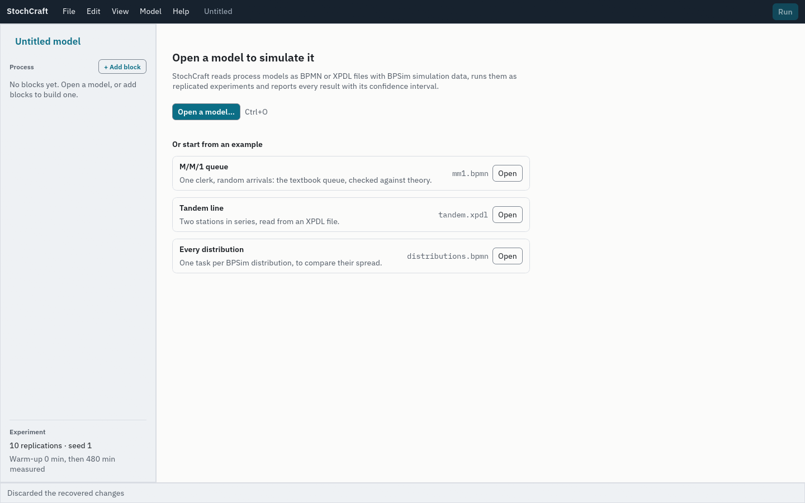
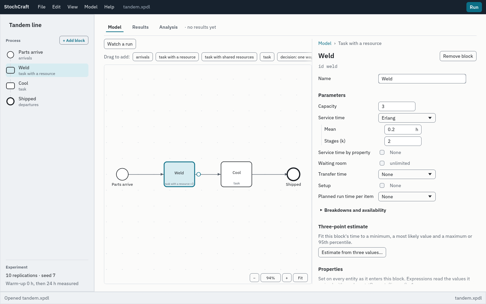
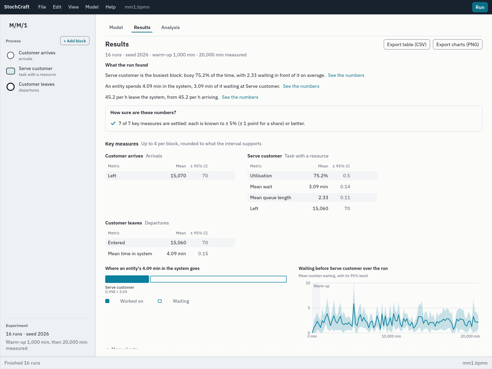
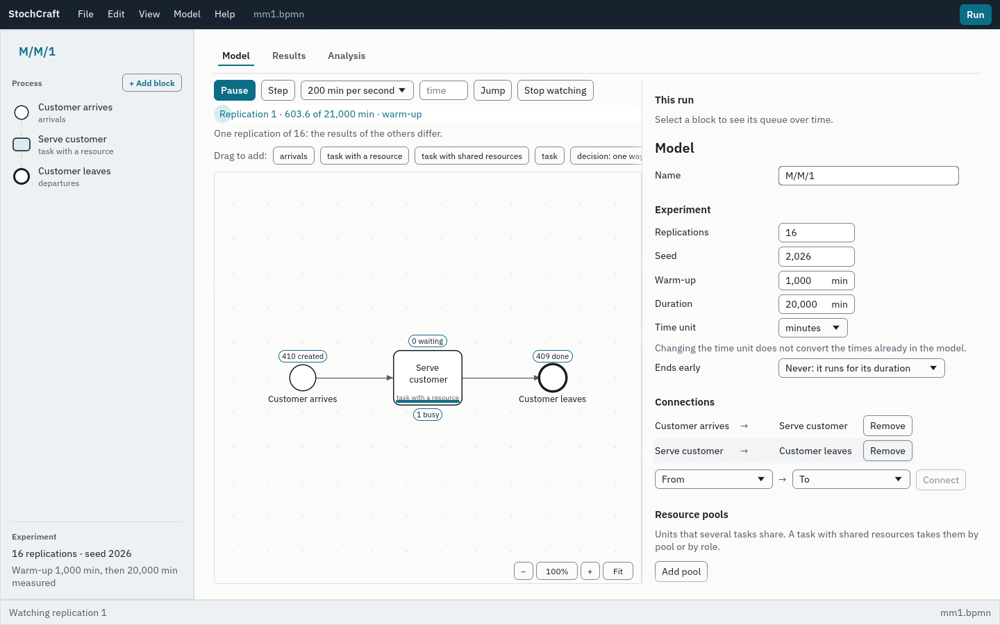

# StochCraft user guide

StochCraft simulates how work flows through a process: parts through a line, patients through a
clinic, requests through a service. You draw the flow, say how long each step takes and how much
it varies, and StochCraft runs the model many times and reports each result with how sure it is.

This guide covers the app, in the browser or on the desktop; both work the same way. Where they
differ, it says so. To get the app, see the [installation guide](installation.md).

- [Words used in this guide](#words-used-in-this-guide)
- [Start: open an example](#start-open-an-example)
- [Build a model](#build-a-model)
- [Set up the experiment](#set-up-the-experiment)
- [Run it](#run-it)
- [Read the results](#read-the-results)
- [Watch a run](#watch-a-run)
- [Other views of the model](#other-views-of-the-model)
- [Ask what-if questions: the Analysis view](#ask-what-if-questions-the-analysis-view)
- [Find the best numbers of servers, operators and buffers, rules and times](#find-the-best-numbers-of-servers-operators-and-buffers-rules-and-times)
- [Drive the runs from an optimiser of your own](#drive-the-runs-from-an-optimiser-of-your-own)
- [Monte Carlo models](#monte-carlo-models)
- [System dynamics models](#system-dynamics-models)
- [Agent-based models](#agent-based-models)
- [Save, open and export](#save-open-and-export)
- [Get help in the window](#get-help-in-the-window)
- [Change how it looks and which keys do what](#change-how-it-looks-and-which-keys-do-what)
- [Keyboard shortcuts](#keyboard-shortcuts)
- [Troubleshooting](#troubleshooting)
- [Limitations](#limitations)

## Words used in this guide

- **Block:** one step of the process on the canvas: arrivals, a task, a decision, departures.
- **Entity:** what flows through the blocks: a part, a patient, an order.
- **Run:** one pass of the model from start to end with its own random numbers (textbooks call
  it a replication). An **experiment** is all the runs together.
- **95% confidence interval (± 95% CI):** the range the true mean most likely lies in, given the
  runs. More runs make it narrower.
- **Warm-up:** time at the start of each run that is simulated but not measured, so an
  empty model filling up does not distort the results.
- **Utilisation:** the share of the time a task's units are busy, counted over the time they are
  on shift. Busy means processing or setting up: a unit that breaks down part-way through a job
  is not busy while it is broken, and one holding a finished entity it cannot pass on (blocked)
  is not busy either.

## Start: open an example

When StochCraft opens with no model, it asks **What do you want to find out?** Each example is a
card with its question, its field, about how long it takes, a strip of its blocks, what it
teaches, and, where its answer has been checked, a tag: **Checked against queueing theory** or
**Matches a published study**. Click a card to open its example. The question buttons (**Where is
the bottleneck?**, **How many people or machines?**, …) and the **Industry** list narrow the
cards; **See all examples** shows every example, the reference models too, under a heading per
field (Services, Manufacturing, Logistics and warehousing, Healthcare, … and Reference last).
**Search examples** above the cards looks through every example, featured or not: type words from
a title, a question or what an example teaches, such as *parcel*, *beds* or *breakdown*, in
English or in the window's language; every word must match. Esc in the box, or the **×** beside
it, clears the search. Every example with a tag has a test that
runs it and compares its results with the exact answer (`crates/engine/tests/examples.rs` and
`benchmarks.rs`).

Beside the examples:

- **New to simulation?** **Build a first model** opens an empty canvas with Getting started in
  Help beside it, and the guide points at the first step (see Get help in the window).
- **Coming from another simulation tool?** **Read the two-page guide** opens
  [Coming from another simulation tool](switching.md): the usual words mapped onto StochCraft's,
  how runs and results work here, and how to bring in a process diagram.
- **Open a file:** **Open a file…**, your recent files (on the desktop), and **Start from a blank
  model**.

The examples are also under **File ▸ Open Example**:

| Example | What it asks |
| --- | --- |
| **Coffee counter** | One barista or two at the morning rush? Checked against the M/M/1 and M/M/2 (Erlang C) formulas. |
| **Emergency triage** | Who waits how long when urgent patients go first? Checked against Cobham's priority-queue waits. |
| **Call centre** | How many callers hang up before an agent answers? Checked against the M/M/c+M (Erlang-A) chain. |
| **Weld and paint line** | Where is the bottleneck, and what do breakdowns at paint cost? Checked against the line's exact Markov chain. |
| **Web service with health checks** | Do health checks that restart busy servers make the queue worse? Checked against the service's exact Markov chain. |
| **Bank with an ATM and cashiers** | Are five cashiers enough when half the customers use the ATM first? From Borshchev and Grigoryev, *The Big Book of Simulation Modeling*, Example 2.2; checked by flow balance (cashiers 91% busy) and, at the one ATM, the Pollaczek–Khinchine wait. A second scenario adds a sixth cashier. |
| **Hospital beds** | How many beds so that fewer than 1 in 50 patients are turned away? Checked against Erlang B, with log-normal stays and, in a second scenario, exponential ones of the same mean; a third has 28 beds. |
| **Machine repair crew** | How many fitters keep six machines running? Checked against the finite-source queue M/M/R//6, with one, two or three fitters as scenarios. |
| **A job shop short of workers** | Is the worker or the machines the constraint? From Maggard, Lesso, Hogg and Phillips (Winter Simulation Conference, 1973): two machines and one worker, and each job needs its machine and the worker at the same time (a task that holds units of two pools at once). Jobs arrive once an hour on average, half for each machine, and take 45 minutes. Served first come first served, the worker is the only constraint, so jobs wait as at one server (M/M/1): 3 service times at 75% busy. Checked against M/M/1 on the worker's utilisation, each machine's (half the worker's; the two add up to the worker's exactly) and the jobs' waits. A second scenario with 54-minute jobs (90% busy) is checked on the worker's utilisation and the waits, 9 service times. |
| **Repairmen with spares** | How many spares and repairmen keep ten machines running? Crane and Iglehart's example (Winter Simulation Conference, 1973): ten machines must run, four spares wait and cannot fail while they wait, three repairmen; a machine fails once an hour on average and a repair takes 15 minutes. Checked against the birth–death chain of the number broken, which gives the paper's 3.47 broken on average, and from it 9.29 running (the paper does not print that one). Scenarios with two or four repairmen, and with no spares or eight, are checked on the machines broken and running; a fourth repairman keeps 9.70 machines running, about as many as four more spares (9.71). |
| **Inspection with rework** | How much longer do parts take when half of them need rework? Checked against the product form of a Jackson network; a second scenario reworks a quarter. |
| **Project finish date** | When will the project finish? Three ten-day activities in parallel, run until the project ends; checked against the maximum of exponential durations (18.3 days on average). |
| **Same mean, different spread** | Does it matter how much service times vary when the average is the same? Three desks with fixed, exponential and very uneven times, checked against Pollaczek–Khinchine (waits of 2, 4 and 10 minutes). |
| **Polling place** | How many voting machines does a polling place need? From Allen, *Introduction to Discrete Event Simulation and Agent-based Modeling*, ch. 6 and 7: ballots of 12.5 or 6.5 minutes, machines allocated by the book's utilisation rule (18 for the long ballot, 10 for the short); checked against Erlang C (a 1.5-minute wait with 18 machines, 9.1 with 16). Two election-day scenarios run until the last of 936 voters has voted; they show the direction only and are not checked. |
| **Mass vaccination hub** | How many doses a day can a vaccination hub give? The inputs of Hanly et al., *BMC Health Services Research*, 2022 (a small hub of 21 staff and a large one of 63); each station's utilisation checked by flow balance, all under 80%, and about 470 doses in an 8-hour day for the small hub. Arrivals are random rather than by appointment and walking times are left out, so the time inside is not checked against the paper. |
| **Prison population** | How many prison places are needed? The case of Brailsford, Churilov and Dangerfield, ch. 8, scaled down 100 times, starting at its equilibrium; the numbers inside checked against the infinite-server network's means (500 petty and 260 serious offenders). A second scenario has fewer petty offenders reoffend. |
| **Penny Fab** | How much work in process does a line need? Hopp and Spearman's four-station line with a fixed number of jobs going round; checked against the practical worst case with random times (1, 4, 8 and 16 jobs) and the best case with fixed times. |
| **Arrivals that keep their distance** | Do arrivals that avoid bunching make a shorter queue? One exponential server (mean 1 minute) fed at 0.8 a minute, once with the gaps between zeros of the Riemann zeta function and once with Poisson arrivals at the same rate. The zeros repel one another (their spacings follow the random-matrix, GUE, law: a hundredth of the gaps are under a quarter of the mean, against a fifth for Poisson), so fewer arrivals find the server busy. Checked against exact G/M/1 theory: the root σ of σ = A\*(μ(1 − σ)), with A\* the transform of the gap distribution, gives a mean wait of σ / (μ(1 − σ)) = 2.05 minutes (σ = 0.672), against 4 minutes for Poisson arrivals (M/M/1). The data are the first 10,001 zeros, computed with mpmath (BSD-3, used only to make the data) by `tools/zeta-gaps/generate.py`, unfolded to a mean gap of 1 and binned into 40 values; the model draws gaps independently from that histogram, so it keeps the gap distribution but not the zeros' correlations. At these low heights the gaps differ from the GUE limit by a few percent (histogram total variation distance 4.4% from the Wigner surmise, variance 0.154 against 0.178). |
| **One machine's availability** | How often is one machine down, and how much work does that cost? From Hristova, Denev and Tsankov, *Environment. Technology. Resources*, 2024: a machine is up 90 hours on average between failures and takes 4.5 hours on average to repair (both exponential), and always has a 30-hour job, which a failure interrupts and which carries on after the repair. Checked against the share of time up, 90 / (90 + 4.5) = 0.952; a failure strikes once every 94.5 hours; the machine works 0.952 of the time and finishes 0.952 / 30 = 0.0317 jobs an hour. A second scenario halves the repair time (0.976). Two numbers of the paper are worked by hand, not checked by the run: with 92.5 hours of planned maintenance per 450 hours of work, the machine is productive 450 / 565 = 0.796 of the time; and a 30-hour job started on a working machine meets no failure with chance 0.952 · e^(−30/90) = 0.682 (the paper prints 0.685, from a failure rate rounded to 0.011). |
| **M/M/1 queue** | How long do customers wait at one busy clerk? Checked against queueing theory. |
| **Four-machine line with weekend breaks** | What do failures and weekend breaks do to a line's output and energy per part? Schmitt et al. 2026, Case A: matches the published throughput. |
| **Seven-machine line with two presses** | Which machine holds back a line with two presses in parallel? Schmitt et al. 2026, Case B. |
| **Tandem line** | Two stations in series, read from an XPDL file (a reference model). |
| **Every distribution** | One task per BPSim distribution, to compare their spread (a reference model). |
| **Parcel sorter** | How many parcels go round the loop because their lane is full? Postal parcel sorting, under Logistics and warehousing: a loop feeds four lanes by product, and diverts send a parcel round again when its lane is full. |
| **Product adoption** | How fast does a new product spread? A system dynamics model (stocks and flows, from an XMILE file): 10,000 potential customers, some buying on their own and the rest after meeting a customer. Checked against the exact solution of its equations (9,087 customers after 12 years). |

To try the whole cycle, open **M/M/1 queue** and press **Run**. The results show a mean wait close
to 3 minutes and about 75% utilisation, which is what queueing theory predicts for this model.



## Build a model

The window has three parts:

- the **left rail**, with the model's name, its blocks in order, and a summary of the experiment
  at the bottom;
- the **canvas** in the middle, where the flow is drawn;
- the **inspector** on the right, which shows the settings of what is selected. On a narrow
  window it moves under the canvas.

The tabs above the canvas switch between **Model**, **Results**, **Analysis**, **Capacity**,
**3D** and **Layout** (see [Other views of the model](#other-views-of-the-model)). **Dashboard**,
beside the tabs, opens a panel of charts beside the model.



### Add blocks

Start a new model with **File ▸ New**. Then add blocks in either of these ways:

- **+ Add block** at the top of the left rail lists every kind.
- The strip above the canvas, **Drag to add:**, has one chip per kind. Drag a chip onto the
  canvas, or click it to add the block after the selected one.

A new block is added after the selected block and connected from it, and gets a name such as
"Arrivals 1". Rename it in the inspector's **Name** field.

| Block | What it does |
| --- | --- |
| **Arrivals** | Entities enter the model here, at random or fixed times. |
| **Task with a resource** | Work that needs one of the task's own units (a machine, a clerk). Entities wait in its waiting room when every unit is busy. |
| **Task with shared resources** | Work that takes units from a resource pool shared with other tasks. Add a pool first. |
| **Task** | A delay that needs no resource, such as cooling or travel. |
| **Decision (one way)** | Sends each entity down one of its flows, by probability or by a condition. |
| **Split or join (all ways)** | Sends a copy down every flow, or waits for one from each incoming flow. |
| **Batch (collect, then send together)** | Collects a number of entities and sends them on as one. |
| **Split batches** | Splits a batch back into its entities. |
| **Conveyor** | A belt that carries entities from one end to the other, with a **Length**, a **Speed**, an **Item length** and a **Gap**. **Accumulating** ticked: entities queue up at the end while the rest keep moving; unticked: the whole belt stops when the entity at the end cannot leave. |
| **Departures** | Entities leave the model here. |

### Connect blocks

- **On the canvas:** drag from the handle on a block's edge to another block.
- **In the inspector:** with nothing selected, the model overview's **Connections** section has
  **From** and **To** lists and a **Connect** button. With a block selected, its **Flows** section
  has **Add a flow from…** and **Add a flow to…**.

Each connection has a **Remove** button.

### Move around the canvas

- Click a block to select it. Shift-click or Ctrl-click adds to the selection, and dragging on
  the background selects everything in a rectangle.
- Scroll, or drag with the middle or right mouse button, to pan. Ctrl+scroll or pinch to zoom.
- The buttons at the bottom right zoom out, show the actual size, zoom in, and **Fit** the whole
  diagram in view.
- With several blocks selected, the inspector shows the properties they share (see
  [Several blocks at once](#several-blocks-at-once)) and can **Align** them and **Spread out**
  them evenly.

### Set what each block does

Select a block to see its settings. The most used ones come first, under **Parameters**:

- **Arrivals:** **Time between arrivals**, and an optional **Arrival limit**.
- **Task with a resource:** **Capacity** (how many units work in parallel), **Service time**,
  **Waiting room** (unlimited unless set), **Transfer time**, **Setup**, and **Planned run time
  per item** for OEE.
- **Task with shared resources:** **Service time** and **Priority**; what it needs from the
  pools is under **Needs**, and **Service time by resource** gives the units of a pool a time of
  their own.
- **Task:** **Duration**.
- **Batch:** **Batch size**.
- **Inside at the start** (under **More settings** on a task or a batch): how many entities are
  already inside when each run starts, instead of an empty start. They join the waiting room at
  time 0 in order: as many as there are free units start a fresh service at once, and the rest
  wait. With a finite **Waiting room**, at most the units plus the room. Results show them as
  **Inside at the start**, and count them as entered.
- **Conveyor:** **Length**, **Speed**, **Accumulating**, **Item length** and **Gap**. Lengths are
  in the experiment's **Length unit**, the speed in that unit per time unit. A conveyor drawn in
  the model's layout (as the parcel sorter example's are) is as long as its drawn path; a
  **Length** typed that differs overrides it, and a warning gives both lengths.
  - **Diverts along a conveyor.** A divert placed in the layout at a distance along the conveyor
    that sends into it is a point on that conveyor: each item rides to it, and as the item's
    front reaches it, the divert chooses a way. If that way is not the default and has room, the
    item leaves the conveyor there; otherwise it rides on. Several diverts can sit along one
    conveyor, each the default way of the one before; items meet them in that order, and at the
    end of the conveyor go down the last one's default way. The conveyor's capacity and spacing
    count over its whole length, and an item may span a divert, so a divert that sends nothing
    changes no time. A divert placed at the very end of the conveyor works as before: the
    conveyor sends into it at its end.
  - **Junctions.** A flow from one conveyor straight to another can carry a junction: inline,
    side transfer or turntable, with a transfer time (0 by default). An item takes its room on
    the next conveyor, crosses in the transfer time, then rides on.

**Times.** Each time is a distribution: pick its type (Constant, Exponential, Uniform, Triangular,
Normal, Log-normal, Gamma, Erlang, Weibull and others) and fill in its values. A Beta has two
shapes and a range, **Minimum** and **Maximum** (0 and 1 unless you change them): Beta(3, 5) with
Minimum 1 and Maximum 4 is a time between 1 and 4, 2.125 on average. If you only know a
minimum, a most likely value and a maximum, use **Three-point estimate ▸ Estimate from three
values…** and StochCraft fits the time for you.

More settings are folded under headings; open them when you need them:

- **Breakdowns and availability:** time to failure, repair time, and availability by calendar.
- **Patience:** entities give up waiting after a time.
- **Balking:** arriving entities may not join the waiting room, more often the more are waiting.
  Choose **Table** (rows of **Number waiting** and the chance it **Joins with probability** from
  that number on; below the first row everyone joins) or **1/(n + 1)** (everyone joins an empty
  waiting room, half when one waits, a third when two do, and so on). Tick **Count those in
  service** to count the entities being served as well as those waiting. Those that balk take the
  flow marked **Balked**, or leave the model; results show **Balked** and **Share balked** for
  the task. To turn away everyone once a given number are waiting, a **Waiting room** of that
  size with a flow marked **Turned away** does the same, and needs no balking.
- **Health check:** take servers out of service when they are overloaded, and back after a
  restart.
- **Properties:** values set on each entity as it enters, for example a product type that
  changes the service time (**Service time by property**).
- **Time in system** (on Departures): tick **Percentiles of time in system** to see the median,
  90th and 95th percentile of the time each entity took from its creation to these departures,
  not only the mean. Give a **Target time** to see the **Share done within the target time**
  (a service level such as "95% done within 3 days"). With **Count only working time on** set to
  a calendar, only the time that calendar is active counts, so a part started on Friday and
  finished on Monday has not waited the weekend. Entities still inside when the run ends are
  left out, which biases these low when work piles up: stop each run once all are done
  (**Ends early**, when as many entities as arrive have left these departures). The mean time
  in system stays on the clock.
- **Takt** (on Departures): the customer demand, to see takt time, cycle time and whether demand
  is met.
- **Quality** (on Departures): mark the parts that leave here as scrap.

On a decision, each outgoing flow has a probability **p** or a condition **if**, and you can set
a **Default flow**. A flow can be marked **Rework**, and on a task with a resource also
**Gave up**, **Turned away** or **Balked**.

### Decision tables

A task, a decision or a divert can use a decision table (OMG DMN 1.6) to route or classify
entities by their properties: parcels to chutes by postcode and size, jobs to a priority by
customer and due date. The table lives in a `.dmn` file beside the model's file, so other DMN
tools can open it too, and the model names the decision it uses (a `stochcraft:decision`
extension in its BPSim data).

- As an entity enters the block, the table is evaluated on the entity's properties and each
  output is written back as a property of that name. A table no rule of which matches gives no
  result (or its default output), and the outputs are cleared. An output must fit the
  property's type: text cannot go into a property of type boolean, nor a fraction into a long.
- A decision none of whose flows out has a condition takes the flow whose id, or whose target's
  id or name, is the output, compared exactly (`true` names only a flow or block called `true`);
  a value that names more than one flow is an error. With conditions, the conditions read the
  outputs. A divert does the same, then takes its default flow if the chosen way is full.
- The hit policies are Unique (at most one rule may match), First (the first match in rule
  order), Priority (the match whose outputs come first in the outputs' lists of values) and
  Collect (with Sum, Count, Minimum or Maximum).
- Cells use the simple tests of DMN's S-FEEL: `< 10`, `>= 2.5`, a value alone (`"express"`,
  `true`), ranges such as `[1..5]` or `(1..5]`, lists separated by commas, `not(...)` and `-`
  for any value. Values are numbers, strings in double quotes, `true` and `false`. A value
  matches only a value of its own kind, so `5` does not match the string `"5"`.
- **Open decision table** on the block's page shows the table as a grid, rules in rows, with
  its hit policy. The app shows tables read-only for now, because it does not yet write `.dmn`
  files: edit a table in its `.dmn` file (in another DMN tool or a text editor), or with the
  `dmn.set` command, which checks it and refuses a table that cannot run with the cell and the
  reason; `file.save` then writes the file beside the model. Editing in the window, with the
  app reading and writing the `.dmn` files beside the model, is next.
- The app's **Save** writes the model's file only. For a model that uses decision tables the
  status bar says so ("Its decision tables were not written"), and a table changed since its
  file was written (by `dmn.set` through the MCP server, say) keeps the model marked unsaved.
- The model's problems include rules that overlap in a Unique table (an error, with an example,
  `null` for an entity without the property) and inputs no rule covers (a warning, with an
  example). Inputs that read the same property are checked with one value.
- Not yet: the hit policies Any, Rule order and Output order; names, dates and durations in
  cells; literal expressions and decisions that require other decisions. A file using them is
  refused with a message naming the construct. Numbers are 64-bit floating point.

### Shared resources and shifts

**Servers that differ in speed.** A task that needs either of two pools, say a faster and a
slower server (**Add alternative** under **Needs**), can serve in a different time depending on
which pool serves. Under **Service time by resource** the inspector has one row per pool the task
can draw on; tick a pool and give its units a **Service time** of their own. The times apply in
this order, and the first that exists is used:

1. the **Service time** of the pool that serves (when one take spans several pools, the pool that
   supplied its first unit);
2. the entity's **Service time by property**, if it has one for its value;
3. the task's own **Service time**.

A pool without a row serves in the task's time (or its time by property). A row for a pool the
model lacks, one the task does not need, or one pool twice is a problem, not ignored. In the
file it is the extension `stochcraft:processingTimeByResource`; from the command line, the
`processing_by_resource` parameter of `block.set` and `block.add` (`{by_resource: [{resource,
time}]}`).

When several units come free at the same instant and entities wait, the units go to the waiting
entities in order of priority, then of arrival, and each entity takes the first of its
alternatives that is free, in the order under **Needs**: with Able listed before Baker, a waiting
customer gets Able even if Baker's job ended first. The capacity table gives no queueing formula
for such a task, since its units do not share one service time.

**Several pools at once.** A task can need units of several pools together, such as a job that
needs a machine and a worker: each requirement has its own alternatives, and an entity takes the
units for every requirement at once, only when all of them can be met, and gives them all back
when it is done. It never holds a machine while it waits for the worker, so tasks cannot
deadlock, and an entity that needs only a machine is served while one needing a machine and the
busy worker waits. The pool that meets the first requirement sets the **Service time by
resource**. Each pool counts its units busy while they are held. The capacity table shows each
pool's load, and no formula for such a task, since it holds several pools. In the file, each
requirement is a resource role of the task (a `performer`) with its own BPSim `selection`; from
the command line, `needs` of `block.set` and `block.add` is the first requirement and
`also_needs` (a list of lists of alternatives) the others. Editing them in the inspector comes
next; until then the inspector edits the first requirement and keeps the others.

With nothing selected, the inspector shows the whole model:

- **Resource pools:** units that several tasks share, such as a team of operators. Click
  **Add pool**, set its **Units**, and give it **Roles** if tasks ask for people by role.
- **Calendars:** periods when availability, arrivals or a pool's shifts change, such as a day
  shift from 08:00 to 16:00 on weekdays. Click **Add calendar**, then **Add period**. Tasks, pools
  and arrivals can then follow the calendar.

### Fix problems

The model overview's **Problems** section lists every error and warning, each with a **Show**
link that selects the block. Blocks with a problem are also marked in the left rail and on the
canvas. When it says **None found. The model is ready to run.**, you are set.

While the model has errors, the header's button says how many, for example **Run (2 problems)**,
and a chip above the canvas names the blocks, for example **2 problems: Paint, Inspect**.
Clicking either (or pressing F5, or **Model ▸ Run**) does not run: it selects the block with the
next error, focuses its field when it is a number such as the capacity or the main time, and
says what is wrong in the status bar. Click again for the next one. An error in the status bar
that belongs to a block selects it when clicked. Warnings alone do not stop a run.

A block's own problems show at the top of its inspector, in a place of fixed height, so the
fields below do not move when one appears.

Fields check what you type: a value that is not a number, or one the model cannot use (a
negative time or mean, a capacity or batch size below 1, a probability outside 0 to 1, such as
a decision's), is outlined and explained under the field, and the model keeps its old value
until you fix it.
Esc, or selecting another block, puts the model's value back in the field.

### The inspector: basics first

A block's inspector shows its basic fields first: its name, capacity and main time (and a task's
waiting room). The rest is folded: **More settings** (transfer, setup, times by property, planned
run time, inside at the start), **Breakdowns and availability**, **Patience** and **Health
check**. A folded section says what is set in it beside its title, for example **Breakdowns:
Exponential 120 min, Constant 6 min**, or **None**; a section with something set starts open.
The **?** beside **Capacity**, **Service time**, **Waiting room** and a task's **Inside at the
start** opens a one-line explanation under the field;
it can be reached with Tab and opened with Enter or Space.

### Changed values in bold, and their reset

A field whose value differs from its default has its label in **bold**, with a reset button
(↺) after it. The default is what a new block of that kind has (a new **Task with a resource**
has one unit and a service time of mean 0.8), or, for a setting a new block leaves out, none. The
reset puts that value back; like any edit, it is one step to undo. Tab reaches the reset right
after its field, and Enter or Space presses it. A screen reader hears the field's label with
**Changed from the default**.

A model opened in a scenario that inherits from another (a BPSim scenario with `inherits`) is
measured against that scenario instead: a value the opened scenario changes is in bold, said as
**Changed from the inherited scenario**, and its reset puts the inherited value back.

### A flow's properties

Click a flow on the canvas to see its own page: the blocks it joins (each a link to that block),
**Remove flow**, and how entities take it: out of a decision, its **Probability** and
**Condition**; whether it is **Rework** (any flow but one out of arrivals); and out of a task
with a resource, the way for those who **Gave up**, are **Turned away** or **Balked**. Each is in
bold, with a reset,
while it differs from a new flow's.

### Several blocks at once

With several blocks selected, the inspector shows **Shared properties**: the fields every
selected block has. Where their values differ the field says so: a number field is empty with a
dash, a choice reads **Mixed values**, and a box is neither ticked nor clear. Typing a value sets
it on all of them; in a distribution, typing one parameter (a mean) keeps each block's other
parameters. A change, or a reset, to several blocks is one step to undo, named **Changes**.

### Undo

Every change can be undone with **Edit ▸ Undo** (Ctrl+Z, ⌘Z on a Mac). The menu names the change,
for example **Undo Rename Block**.

## Set up the experiment

With nothing selected, the **Experiment** section of the inspector sets how the model is run:

- **Runs:** how many independent runs. More runs give narrower confidence intervals but
  take longer.
- **Seed:** the starting point of the random numbers. The same model and seed always give the same
  results.
- **Warm-up:** time simulated before measuring starts. The other way to avoid results biased by
  a start from empty is to start full: set **Inside at the start** on the busy tasks to about
  the numbers they hold in a typical run. Their services start afresh at time 0.
- **Duration:** how long each run is measured, after the warm-up.
- **Time unit:** the unit for every time in the model. Changing it does not convert the times
  already in the model.
- **Length unit:** the unit for conveyor lengths (metres unless set).
- **Ends early:** stop each run when enough entities have left a block, or when a task
  empties, instead of after its duration.
- **How many runs:** **Exactly that many**, or **More until precise enough**: the runs set above
  come first, then more follow in batches until every key measure that varies is within its
  target (± 5% of its mean, ± 1 point for a share such as utilisation, by default), or the most
  runs (200 by default) is reached. A result that is the same in every run, such as a count the
  model fixes, is never counted as settled, but it does not hold back the others. A run that
  stops at 40 gives exactly the results of 40 runs set by hand.
- **Observed data:** real measurements to check the results against, from the system the model
  stands for. Choose a result under **Add an observed value** (a block or a pool, and a result
  such as **Mean wait** or **Utilisation**), then say what you know of it: an **Observed value**,
  with the half-width of its own 95% interval if its data give one (**Its 95% half-width**) and
  a **Tolerance** (the difference you accept as agreement, in the same unit; 0 for none), or
  **At most** or **At least** a bound the result must meet, such as "the mean wait is under
  2 min". Times are in the model's time unit and a share such as utilisation is a percentage.
  **Remove** takes one out. The results then say whether the run agrees: see
  [Check the results against observed data](#check-the-results-against-observed-data). An
  observed value for a block that was later removed is listed under **Problems** (a warning, and
  the run still goes); remove it, or choose a block that exists.

The left rail's summary shows the current settings, for example "10 runs · seed 7".

## Run it

Press **Run** at the top right, or F5, or **Model ▸ Run**. A progress bar shows how many
runs have finished; **Cancel run** (or Esc) stops it. The status bar then says
"Finished 10 runs" and the **Results** tab opens. Before the first run, the **Results** tab says
**No results yet**, with a **Run** button.

In the browser, the runs go in parallel on every processor core but one, up to 16.

Results belong to the model as it was run. When you change the model, they stay on the
**Results** tab, marked **Out of date: the model has changed since this run**, with **Run again**
(the tab says "· out of date"). Undoing the change makes them current again; moving a block does
not count as a change.

## Read the results



The **Results** tab shows, from the top:

1. **The run record:** runs, seed, warm-up and measured time, so you can reproduce the
   numbers.
2. **What the run found:** two to four sentences that answer first: which block limits the flow
   (or is only the busiest, when what comes after it holds it back), how much of an entity's time
   in the system is waiting and where, and what leaves against what arrives. **See the numbers**
   scrolls to the block behind each one. If the runs split into two different outcomes (some
   lines collapse while others recover), it says so instead of reporting a mean that fits
   neither.
3. **How sure are these numbers?** The key measure known least well, with a button to **Use N
   runs** that brings it to about ± 5%, a button to **Set a warm-up** when the start from empty
   pulls the means away, and how many key measures are already settled. A time or a count is
   settled at ± 5% of its mean; a share, such as utilisation, at ± 1 percentage point. After
   **More until precise enough**, it says why the runs stopped and after how many, offers
   **Allow up to N runs** when the most was reached first, names the key measures not yet within
   the run's targets (it judges them by its own targets, not the ± 5% above), and any result that was the
   same in every run, with how often something none of the runs met could still happen (about
   3 in N runs at most). The ± is then called the estimated precision: the number of runs was
   chosen from the results, so the interval may cover the true mean less often than 95%.
4. **Key measures:** up to four per block (for a task: utilisation, mean wait, mean queue length,
   and time failed when it fails). Every mean is rounded to what its interval supports: "38 ± 12"
   rather than "38.42 ± 12.31".
5. **Two charts:** where an entity's time in the system goes (time worked on and waiting at each
   task, for a model that is one straight line; the mean wait per block otherwise), and the
   waiting before the busiest block over the run, with its 95% band and the warm-up shaded.
   Hover for the numbers. The other charts (utilisation, queue length, time in system, blocked and
   lost) are under **More charts**.
6. **All measures:** every other result in a table per block, folded. Tasks with a resource also
   report the time spent processing, starved, blocked, failed, off shift and setting up, and OEE
   when a planned run time is set. Departures with a demand report takt time, demand met and
   cycle time, and those with **Time in system** its percentiles and the share within the
   target, for each run over the entities that reached them.
7. **Spread across runs:** pick a result to see its percentiles and how often it met a
   target, for example "the wait is at most 5 minutes in 14 of 16 runs".

**How sure is a number?** "2.99 ± 0.09" means the mean is most likely between 2.90 and 3.08. If
the ± is large compared with the difference you care about, add runs. Notes under the
table explain anything left out, such as entities still inside at the end.

### Compare with a baseline

To see what a change does, click **Keep as baseline** under the run record, change the model
(for example a faster service time), and run it again. Over the new results you then see:

- **Changed since the baseline:** what is different in the model, block by block, with both
  values, for example "Paint › Service time, Mean: 5.2 → 4.6". A change that was undone is not
  listed; moving blocks is not a change.
- **How the runs were compared.** With the same seed and number of runs, run 1 of each meets the
  same random numbers, and so on, and the runs are compared in pairs: the difference comes from
  the change, not from chance draws. With another seed or number of runs (for example after
  **Use N runs**), they are compared as independent runs, and the intervals are wider.
- **What the change did:** the largest real changes in sentences, for example "Mean wait (Paint)
  fell from 38 min to 17 min, by −21 ± 6 min: more than chance would explain".
- **Baseline and now, key measures:** each block's key measures in both runs, the difference with
  its 95% interval (shares in percentage points), a mark of the change against a zero line, and a
  verdict: **Real: lower**, **Real: higher**, **Could be chance**, **No change** (every run gave
  the same value), or **Too few runs to tell**. A verdict is real when the difference's interval
  leaves out zero. Each row is judged on its own, so with many rows one may look real by chance.

**Keep this as the baseline** makes the new run the baseline; **Clear baseline** removes it.
Opening another model or file clears it too.

### Check the results against observed data

A model is worth trusting when it gives what the real system gives. With observed data set in the
experiment (see [Set up the experiment](#set-up-the-experiment)), the results have a **Checked
against observed data** section above the key measures, one line for each, and a **Finding** at
the very top for each that differs or fails. Each line gives the result, what it was checked
against, the simulated mean with its 95% half-width, and a verdict in words:

- **An observed value** is checked by the 95% interval of the difference (simulated mean minus
  observed value), shown with the line. With a half-width of its own for the observed value, the
  difference's half-width is the square root of the sum of the two half-widths squared (the usual
  large-sample approximation for two independent estimates); without one, the observed value is
  taken as exact and the difference's half-width is the simulated mean's. There are three
  outcomes:
  - **Differs:** the interval excludes 0 (with a tolerance: it lies wholly outside it). The model
    and the real system are not the same on this result.
  - **No difference detected:** the interval holds 0, and no tolerance is set. This is **not**
    agreement: an interval holds 0 when the runs are too few or too noisy to tell, so a wide
    interval around any value "agrees" with the observed one. Run more, or set a tolerance.
  - **Agrees within ±T:** only with a **Tolerance** T, set in advance as the difference you would
    accept, and only when the whole interval lies inside -T to +T. If it lies wholly outside, the
    result differs; if it straddles an edge, it is **Inconclusive at current precision**. This is
    an equivalence test, in the manner of two one-sided tests (Schuirmann); using the 95%
    interval is conservative against the 90% interval of the exact test, so it asks for slightly
    more runs than it needs.
- **A bound** is decided by the whole simulated 95% interval, never by the mean alone. It
  **passes** when the whole interval meets the bound, **fails** when the whole interval violates
  it, and otherwise is **Inconclusive at current precision**, because the interval straddles the
  bound; more runs narrow the interval. A mean just under "at most 2" with an interval reaching
  past 2 is therefore not a pass.
- With fewer than 2 runs there is no interval, so every check is inconclusive.
- **No result** means the run has no such result: the block is gone, or does not report that
  result (a source has no utilisation).

The lines are ordered with those that differ or fail first, then those inconclusive or with no
difference detected, then those that agree or pass.

These checks follow the black-box validation of Law (*Simulation Modeling and Analysis*, 5th ed.,
section 5.6.2) and Sargent (2013). An agreement is not proof the model is right: it says only
that this run's result is within the tolerance you chose of the real system's, and a model can
agree on one result and differ on another. The observed data are part of the
experiment, so changing them marks the results out of date; run again to check against the new
ones. They are saved with the experiment in the file, and the command line prints the same
section.

## Watch a run

To see the model move, click **Watch a run** in the run bar above the Model and 3D views, press
Space on either of those views, or choose **Model ▸ Watch a Run**. It plays the first run on the
canvas: each block shows how many entities were created, are waiting, are busy or are done. The
run bar is for watching one run; **Run** in the header runs the whole experiment, fast and
without animation.

- **Play/Pause** (Space), **Reset** (back to the start, paused), and **Step** (`.`) to the next
  event.
- **Speed** as ×N, in model time units per second: `[` halves it, `]` doubles it, and **As fast as
  possible** runs flat out.
- The clock shows the model time, how much of the run is done, and **warm-up** while it lasts.
- Type a time and click **Pause at** to play on and pause when the clock gets there.
- Select a block to see its waiting room over time in the inspector, under **This run**.
- **Stop watching** returns to editing.

This is one run of many: its numbers differ from the others and from the averages in
**Results**.



## Other views of the model

- **Capacity:** what each station can carry, worked out from the model before any run: its
  arrivals, service, units, utilisation and load, a status (**Fine**, **Congested**, **Unstable**
  or **Unknown**) against a **Target utilisation** (85% unless changed), and the mean wait where a
  queueing formula holds. Under the table it names the bottleneck and says what cannot be known
  before a run. Once the model has results, the simulated utilisation and mean wait stand beside
  the worked-out ones. `stochcraft-cli explain` prints the same table.
- **3D:** the model's layout in 3D: conveyors as belts with side rails and legs along their drawn
  paths, and each placed block as a shape for its kind (a packing station with its packer, a
  pallet of cartons where parcels arrive, a roll cage where they leave, a control cabinet at a
  divert). Drag to orbit, scroll to zoom, Shift-drag to pan, and **Fit** to see it all. While a
  run is watched, each item on a conveyor is drawn as a parcel where the run has carried it, in
  its product's colour.
- **Layout:** a plan of the model from above, to scale in metres, with a grid and a scale bar.
  Conveyors are drawn as their belts and blocks as their footprints. Drag the floor to pan, scroll
  to zoom, **Fit** to see it all. Positions come from the model's layout (the view says
  **Positions from the layout**); a block the layout does not place is listed under **Unplaced**
  and drawn in neither view, so a model with no layout yet shows an empty plan and 3D view. The
  parcel sorter example has a layout.
  - **Draw a conveyor's path.** Select the conveyor (on the plan or in the flowchart) and click
    **Draw path**, or click the conveyor under **Unplaced**, which starts drawing straight away.
    Click where the belt starts and at each point it turns, then double-click, press Enter or
    click **Finish**; Backspace takes back the last point and Esc cancels. Each corner bends round with a radius of 1 m (tighter where the
    straights beside it are too short). The conveyor's **Length** becomes the drawn path's,
    unless a typed length already overrode the path, which it keeps.
  - **Edit it.** Click a belt to select it: its points show as small circles. Drag a point to move
    it, drag the belt itself to move the whole path, double-click the belt to add a point there,
    and press Delete to remove the point you picked (a path keeps at least two). The length
    beside the pointer follows the drag. Every change is one step of **Undo**.
  - **Without a mouse.** Tab reaches each point; the arrow keys move it 0.1 m (1 m with Shift)
    and Delete removes it. The conveyor's properties list its path under **Path**: the **Drawn
    length**, each point's x and y and each corner's bend radius as fields, **Remove** for a
    point, **Add a point at the end**, **Add a straight path** (of the typed length, for a
    conveyor not drawn yet) and **Remove path**. A path that climbs, has a helix, turns a whole
    circle or more in one arc, or turns sharply where it starts or ends or by a half turn or more
    (drawn in a file, or by an agent) can be moved, drawn again or removed here but not edited
    point by point; a loop drawn by its points keeps them.
  - Snapping to the grid and to other belts' ends, and a background drawing to trace over, come
    next.
- **Dashboard** (beside the tabs, or **View ▸ Dashboard**): a panel beside the model with tiles
  for throughput, utilisation by resource, time on conveyors, and entities on the conveyors (or
  in the model) over time. Run the model, or watch a run, to fill it. While a run is watched, the
  throughput is that run's so far; the resource and conveyor charts show the last full run until
  the watched one ends.

## Ask what-if questions: the Analysis view

The **Analysis** tab runs the experiment several times with the same seed, so the differences
come from your change, not from chance. Each analysis can take a while.

- **Sweep a parameter:** pick a **Parameter** (for example a task's units or mean service time)
  and a **Result**, type the **Values** to try ("1; 2; 3"), and click **Run the sweep**. It says
  whether the result changed by more than chance would explain.
- **Which parameters matter:** moves each parameter down and up by a percentage and ranks them by
  how much the chosen result moves.
- **Size the resources:** adds a unit at the busiest task or pool until enough runs meet a
  target, such as "mean wait at most 5 minutes in 70% of runs". **Use these units in the
  model** applies the answer as one change you can undo.

## Find the best numbers of servers, operators and buffers, rules and times

`stochcraft-cli optimize` searches whole-number decisions (a task's units, a pool's units, a
buffer) for the design with the lowest cost, or the highest value, of results and decisions
together. Then it says how sure it is. For two desks in tandem, with 20 an hour for each server
and 50 an hour for each customer waiting:

```bash
stochcraft-cli optimize two-desks.bpmn \
  --decide desk1.capacity=11..40 --decide desk2.capacity=6..35 \
  --minimize 'desk1.mean_queue_length*50' --minimize 'desk2.mean_queue_length*50' \
  --cost desk1.capacity=20 --cost desk2.capacity=20 --delta 2
```

It starts from the model's numbers (or `--start desk1.capacity=14`, one of the range's
values) and a few other starting points, and visits designs near the
best found so far. Then it compares the best few again, on new replications, so that a design
that only looked good by chance is not chosen. The answer reads like "With 95% confidence,
(14, 8) is the best, or within δ = 2 of the best, of the 7 designs compared at the end
(312 tried)", followed by the table of those designs. That statement is about the designs
compared at the end, not every design there is. When the whole space has at most 50 designs and
the budget pays for 10 runs of each, every one is compared and the answer says "of all 48
designs".

- `--delta` (δ) is the smallest difference in the objective worth telling apart, in its unit (here
  money an hour). A smaller δ needs more runs.
- `--cost-cap 420` keeps the decisions' costs at most 420; designs over it are never run.
- `--constraint 'desk1.mean_wait<=0.05~0.005'` (quoted, so the shell does not read `<` as a
  redirection) keeps a result's mean at most 0.05, with a
  tolerance of 0.005: a design within the tolerance of the limit may count either way. With only
  `--cost` and constraints, it finds the cheapest design that meets them ("the fewest servers that
  keep the mean wait under 3 minutes").
- `--max-runs` is the budget in runs (default 10,000); 30% of it is kept for the final comparison.
  When the budget runs out first, the answer says "best found, not proven best" and lists the
  designs still in contention. `--time-limit` stops the search after that many seconds.
- A model with no randomness (nothing in it is drawn) is "compared exactly", one run per design,
  with no probability. Results from a model that draws random numbers are never taken as exact,
  even when designs give the same values in every run so far: a rare event may simply not have
  happened yet. When two designs give the same difference in every run of the final comparison's first
  stage, the answer says "best found, not proven best" and why. An objective of costs alone
  (`--cost` with constraints, no result in the objective) is known exactly, so the designs that
  meet the constraints are compared on it exactly.

It also chooses between rules and searches a mean:

- A rule: `--decide split.routing` compares a gateway's random split (`standard`) with sending
  each item to the shortest queue (`shortest_queue`); `--decide split.routing=standard,divert`
  names the levels to compare. A task's `on_shift_end` (`finish`, `retry`, `resume`; the task
  needs shifts) and a mobile pool's `after_job` (`stay`, `go_home`) work the same way. Every
  combination of the rules' levels (at most 8) is tried, and all of them meet in the final
  comparison.
- A mean: `--decide server.mean=0.2..0.9` searches the server's mean service time between 0.2
  and 0.9, the shape of its distribution kept. `--cost server.mean=-4` gives each unit of it a
  cost (here a slower machine is cheaper). The search is Nelder–Mead, which moves a small
  triangle of trial values (a segment, for one mean) downhill; it is a local search, and the
  answer says so: it does not show that no better value lies elsewhere in the range. One or two
  means at a time; with counts or rules beside them, the counts and rules may take at most 8
  combinations of values.

Scripts and agents use the engine command `experiment.optimise` ([mcp.md](mcp.md)); its `apply`
makes the chosen design the model's, as one change you can undo.

## Drive the runs from an optimiser of your own

StochCraft's searches answer "which of these is best" with a stated confidence. To use a search
of your own instead (Optuna, pymoo, or code in any language), let it choose the values and let
StochCraft run them: `stochcraft-cli evaluate` takes values of the decisions and a range of
replications, and gives back each result's value in every replication, with their mean and 95%
interval.

```bash
stochcraft-cli evaluate examples/optimisers/mm1-cost.bpmn \
  --decide server.mean=0.5 --range server.mean=0.2..0.9 \
  --result server.mean_work_in_progress --first 0 --count 10
```

A decision is named as `id.field`, the field being `capacity`, `quantity`, `queue_capacity` or
`mean` (as for a sweep or a designed experiment), and a result as `element.metric`. Without
`--decide`, the command reads one evaluation per line of standard input and writes one JSON line
back for each, so a program keeps one `evaluate` running and talks to it line by line:

```json
{"decisions": [{"id": "server", "field": "mean", "value": 0.5}], "first": 0, "count": 5}
```

The answer has `values` (the result in each replication, in order), `mean`, `half_width` and `n`
for each result, with the `decisions`, `seed`, `first` and `count` it ran. A line can also give
`results` and `seed`; `--result`, `--seed`, `--first` and `--count` give what a line leaves out,
and `--range` the range each decision's value must lie in. A decision the model does not have, a
value of the wrong kind or out of its range, or a decision given twice is answered with
`{"error": {...}}` naming the decision, and the next line is read as usual; the command then
exits with 1. Replications count from 0.

Two things make the numbers fair to compare. Every evaluation uses the same seed, so replication
*i* of every candidate meets the same random numbers (common random numbers), and a difference
between two candidates comes from the decisions, not from chance. And replication *i* depends
only on the seed and *i*, so replications 0–4 and then 5–9 give exactly what 0–9 give at once:
a search can give a candidate a few replications, and more only while it looks promising. The
engine command is `experiment.evaluate` (for scripts and agents, [mcp.md](mcp.md)).

The two examples below choose the mean service time *s* of an M/M/1 server, with arrivals at
rate 1, between 0.2 and 0.9. The cost is the mean number at the server, *s* / (1 − *s*), minus
4*s* (a slower machine is cheaper), so it is least at *s* = 0.5, where it is −1 (−0.933 at 0.4,
−0.9 at 0.6). The model and the scripts are in `examples/optimisers/`; `stochcraft_evaluate.py`
there keeps one `evaluate` running and sends it a line per evaluation. CI runs both scripts and
checks that each ends within 0.05 of 0.5.

**Optuna, asking and telling** (`optuna_mm1.py`; `pip install optuna`). Each trial gets
replications 0–4; Optuna's median pruner stops it there if it is worse than the median of the
earlier trials, and otherwise it gets 5–9 too:

```python
study = optuna.create_study(direction="minimize",
                            sampler=optuna.samplers.TPESampler(seed=1),
                            pruner=optuna.pruners.MedianPruner(n_startup_trials=5))
for _ in range(40):
    trial = study.ask()
    s = trial.suggest_float("s", 0.2, 0.9)
    costs = cost(evaluator.evaluate({"server.mean": s}, first=0, count=5), s)
    trial.report(sum(costs) / len(costs), step=0)
    if trial.should_prune():
        study.tell(trial, state=optuna.trial.TrialState.PRUNED)
        continue
    costs += cost(evaluator.evaluate({"server.mean": s}, first=5, count=5), s)
    study.tell(trial, sum(costs) / len(costs))
print(study.best_trial.params["s"])
```

where `cost` gives each replication's mean number at the server minus 4*s*.

**pymoo** (`pymoo_mm1.py`; `pip install pymoo`). The problem's one variable is *s*, and each
candidate runs replications 0–9; pymoo's pattern search (Hooke and Jeeves) follows the cost
down:

```python
class ServiceTime(ElementwiseProblem):
    def __init__(self, evaluator):
        super().__init__(n_var=1, n_obj=1, xl=np.array([0.2]), xu=np.array([0.9]))
        self.evaluator = evaluator

    def _evaluate(self, x, out, *args, **kwargs):
        s = float(np.clip(x[0], 0.2, 0.9))
        answer = self.evaluator.evaluate({"server.mean": s}, first=0, count=10)
        out["F"] = [answer["results"][0]["mean"] - 4 * s]

result = minimize(ServiceTime(evaluator), PatternSearch(), termination=("n_evals", 60), seed=1)
print(result.X[0])
```

Run them with the path to the command line: `python optuna_mm1.py path/to/stochcraft-cli`.
What such a search finds is the best it found, not a proven best: neither method says how sure
it is that nothing it did not try is better.

## Monte Carlo models

A Monte Carlo model is a calculation, not a process: a project's cost, a budget, a capacity
check. Its **inputs** are uncertain numbers, each a distribution (a duration between 8 and 16
days, most likely 10); its **outputs** are worked out from them (the cost is the duration times
the day rate, plus materials). Each **trial** draws every input once and works out every output;
thousands of trials show how the outputs spread, and how likely each is to miss its target.

Open the example **Will the project come in under budget?** from the start page, or start one
with **File ▸ New Monte Carlo Model**. A Monte Carlo model has two tabs, **Model** and
**Results**, and no canvas.

On the **Model** tab:

- **Inputs:** each has a unit and a distribution, edited the same way as a task's time. Type a
  name under the inputs and click **Add input** for another. **Paste inputs from a table** takes
  lines of name, distribution, parameters and unit, copied from a spreadsheet or written as CSV
  (`labour,triangular,min=80;mode=100;max=150,h`); **Export inputs (CSV)** saves the same table.
- **Correlations:** two inputs that tend to move together (a busy market raises both the day
  rate and the price of materials) get a rank correlation from -1 to 1. Correlations that cannot
  all hold together are refused, with the reason under them.
- **Outputs:** each is an expression over the inputs and the outputs above it, each named as
  `$name`: `$duration * $day_rate + $materials`. An expression that cannot be read stays in its
  field with the reason under it. Give an output a **Target**, **At most** or **At least** a
  value, to see the chance of missing it.
- **Controls:** a way to get a narrower interval from the same trials. A control is an input whose
  mean is known (every input says its own, so a labour time with a triangular distribution
  qualifies), or an earlier output whose mean you know and give. Pick one in an output's
  **Controls** row with **Add a control**. It helps when the control moves with the output: a
  cost that is mostly labour is helped by labour as a control, a cost that depends on something
  else is not. The results use how closely they move together to correct each trial for how
  far the control happened to land from its known mean. The first 1,000 trials only measure
  that relationship (for a random run under 2,000 trials, the first half; with antithetic
  sampling it is rounded to whole pairs), so the corrected mean and chance are worked out from
  the trials after them. With Latin hypercube or Sobol sampling, or with correlated inputs, the
  trials come in batches of 1,000 and the whole first batch only measures: one batch gives no
  corrected result, two give a corrected mean, and three give its interval. For a run of a fixed
  number of trials that keeps the corrected mean unbiased; a run that stops when a precision
  target is met can still be biased by the stopping rule, whether or not the first trials are
  left out. If some trial gives no number (a square root of a negative number, say), there is no
  corrected result, because the control's known mean does not fit the trials that remain. The
  window says how
  much narrower the interval became ("They narrowed the interval by 63%") and then shows the
  corrected mean and chance as the headline; where the control did not help, because it hardly
  moves with the output, or made the interval wider, it says so and the plain result stays. The
  percentiles, histogram and extremes are not corrected. A constant and a count with a very large
  spread cannot be controls, with the reason in the row. For an earlier output the mean you give
  must be exact: a wrong mean biases the corrected result, and gives a narrow interval around a
  wrong value. When the trials are far from a mean you gave, the window warns, keeps the plain
  mean and chance as the headline however much narrower the corrected interval is, and shows
  the corrected figures only beside it (the **Mean** and **Controlled mean** rows); the command
  line labels them "biased, not used".
- **Trials and sampling:** the number of trials (10,000 for a new model), the seed, and the
  sampling. **Latin hypercube** cuts each input's range into equally likely strata (the same
  chance of a draw in each, not equally spaced values) and draws once from each, which usually
  makes the results more precise; it does not promise fewer trials for every output.
  **Antithetic pairs** make trials two at a time, the second from the opposite end of every
  input's range from the first (where the first drew the 30th percentile, the second draws the
  70th), and the mean is the mean of all the valid trials, with a ± across the pairs (they
  are the independent units; where a pair has lost a trial that gave no number, the ± is the
  ratio estimator's, which allows for pairs of one trial and of two, and a pair with neither is
  left out); for an output that rises or falls with its inputs the pair's errors tend to cancel,
  so the results are usually more precise for the same trials, but for an output that peaks
  in the middle of an input's range they may not be, and they cannot be used with correlated
  inputs, which reorder the trials. **Quasi-random (Sobol)** draws spread the trials evenly
  over the inputs' ranges instead of by chance, with a fresh random scramble in every batch of
  1,000 so that the batches are independent; it usually does best for a smooth output of a few
  inputs, and has points for up to 64 inputs. On the command line, `stochcraft-cli run model.bpmn
  --sampling antithetic` or `--sampling quasi-random` chooses it for one run. **How many trials** can be **More until precise enough**: trials are added until every output's mean is
  within the share you set, or until the most you allow has run; in that case the results say
  the target was not met. With Latin hypercube or Sobol sampling or correlated inputs the
  trials run in whole batches of 1,000, so the most must be at least 1,000, and a most that is
  not a whole number of batches is rounded down: a most of 1,500 stops at 1,000 trials, a most
  of 2,500 at 2,000. With antithetic pairs the trials run in whole pairs, so a most is rounded
  down to an even number. With plain random sampling the most is used as it is.

Every change is one step you can undo. **Run** (F5) makes the trials a few batches at a time,
so the window stays responsive, also in the browser.

The **Results** tab answers the question first:

- **What the run found:** for an output with a target, the chance of missing it in words, such as
  "About a 1 in 5 chance that cost is more than 46,000 USD (21%)", with the 95% interval of that
  chance. For an output without one, where 9 trials in 10 fall and its mean.
- For each output: the mean ± the half-width of its 95% interval, the standard deviation, the
  minimum and maximum, the 5th, 10th, 50th, 90th and 95th percentiles, a histogram (how many
  trials gave each value) and the cumulative curve (the share of trials at or below each value),
  with the target drawn on both.
- **How sure are these numbers?** says what each ± is across. With plain random sampling and no
  correlations it is across the trials. Latin hypercube sampling, Sobol sampling and correlations
  make the trials within a batch of 1,000 depend on each other, so there it is across batches
  (with Sobol sampling each batch has a random scramble of its own, so the batches are
  independent), and the trials run in whole batches: 2,500 trials asked for run as 3,000, and the
  results say so. With antithetic pairs the two trials of a pair depend on each other and the
  pairs do not, so it is across pairs. How many batches or pairs the ± is across is in the same
  place; with fewer than two there is no ±. Where every trial (or batch, or pair) gave the same
  value, the results say "No variation was observed" and give no ± at all, not a ± of 0: a
  rare event that none of the trials reached looks exactly like an output that cannot vary, so
  the run cannot show the mean is exact.
- The line under **Results** gives the trials, the seed and the sampling, and how a run with
  **More until precise enough** stopped. **Export table (CSV)** saves a row per output.
  With controls, the lines under an output's finding name them and say what they did, and its numbers
  have a **Controlled mean** row; the CSV (and `run --format csv`) add the controlled mean, its
  half-width, how much narrower it is and the controlled chance of meeting the target.
- **Which inputs matter**, for each output, says in words which input changes it most: "duration
  changes most with build: it goes from 29.02 to 38.58 days as build goes from its 10th to its 90th
  percentile, the other inputs at their medians". That is the largest change between the two
  endpoints, not the largest share of the variation (the shares, below, are that): an input
  that moves the output up and down along its range (a square, say) can show a small or no
  swing, so the results name each input whose output at its median lies outside its two
  endpoint values and say the swing understates it. Under it, a tornado chart: one bar for each input, from the output with that input at
  its 10th percentile to the output with it at its 90th, and every other input at its median (the
  median, not the mean, so a skewed input swings about the same middle either way; this is the
  swing of decision analysis, Clemen and Reilly, *Making Hard Decisions*). The widest bar is first,
  and the line is the output with every input at its median. The bars need no trials, so they
  do not change with the seed. Then a table of each input's rank correlation with the output,
  worked out from the trials: close to 1 or -1 means the output goes up or down with the input.
  An input that is a constant is left out. The bars change one input at a time, so they leave out
  what correlated inputs do together, and a correlated input's rank correlation includes the effect
  of the inputs it is correlated with: the results say so when the model has correlated inputs.
  **Work out each input's share of the spread** adds two columns to that table (the variance-based,
  or Sobol, indices). **Alone** is the share of the output's variation an input explains by itself;
  **With interactions** adds what it explains together with the other inputs, so it is the larger
  when inputs act together (in a product, say) and the same when the output is a sum. Rest the
  pointer on a share for its 95% interval. It runs on request, because it evaluates the model
  1,000 × (inputs + 2) times (6,000 for 4 inputs, which the button says), with its progress in the
  status bar; **Cancel** or Esc stops it. It needs independent inputs, so a model with correlated
  inputs has no button and the results say why. An output that has no number for some of the
  evaluations (a division by zero for part of the inputs' ranges, say) gets no shares, with how
  many of the evaluations lacked one, because the evaluations left out would depend on the
  inputs; the other outputs keep theirs. Editing the model takes the shares away.

## System dynamics models

A system dynamics model is **stocks** (levels, such as customers or inventory) that fill and
drain through **flows** (rates), with **auxiliaries** (other quantities worked out from them),
over time. It is an **XMILE** file (`.xmile` or `.stmx`): open it with **File ▸ Open…** or drop it
on the window, or open the example **Product adoption** from the start page. A model that uses
arrays or modules is refused, with the reason. There are three tabs, **Model**, **Diagram** and
**Results**.

**Model** shows the model: its settings, the checks' warnings and a table of its variables. You
change it on the Diagram tab, or with commands, from an agent through the MCP server or from the
command line (`stochcraft-cli`); the tab reads the model again whenever it changes.

- Its name, and its settings in a sentence: from when to when, the time step and the method
  (Euler or fourth-order Runge-Kutta).
- **Problems:** the warnings from the checks (units that do not balance, a time step that is large
  against a delay), or that none were found.
- **Variables:** each one's kind (stock, flow or auxiliary), equation (for a stock, its starting
  value), units and, for a stock, the flows into and out of it.

**Diagram** draws the model as stocks and flows and lets you edit it. Stocks are rectangles,
auxiliaries circles, and a flow is a pipe (two parallel lines) with a bow-tie valve on it; where a
flow has no stock at one end the pipe ends in a cloud. A thin curved arrow between two variables
means the second uses the first in its equation. Names are under the shapes. Scroll to pan,
Ctrl+scroll or pinch to zoom, drag the background to pan, and **Fit** brings the whole model into
view.

- **Select:** click a variable, or press Tab to go through them in name order (a ring shows where
  the keyboard is). The panel beside the diagram shows its kind, name, equation (for a stock, its
  initial value) and unit. Type in a field and press Enter, or move on, to change it; Escape gives
  the change up. If the model cannot take it (an unknown name, an equation that depends on itself)
  the reason is shown under the field and nothing changes.
- **Move:** drag a stock, an auxiliary or a valve. The pipes at a stock follow it. Each move is
  one step of **Undo**.
- **Add:** pick **Stock** or **Auxiliary** and click the diagram to place one (or press Enter on
  the diagram to put it in the middle); it is named Stock 1, Auxiliary 1… and starts at 0, for you to
  edit. Pick **Flow** and drag from a stock, or from empty space (a cloud), to another stock or to
  empty space; the stocks' inflows and outflows are set for you. Pick **Link** and drag from a
  variable to another to draw a link; the next time the second variable's equation is edited, a
  link its equation does not use is dropped, so edit the equation to use the first as well.
- **Delete:** press Delete with a variable selected, or use the panel's **Delete** button. A
  variable another equation uses, or a flow a stock lists, is refused, and the message says what
  uses it. Escape puts the tool back to Select.
- Every change is one step of Undo and Redo (Edit menu), named for what it did: Add Variable, Edit
  Variable, Remove Variable or Change Diagram.

**Results** runs the model. A model with no random function runs once, and shows at once. One with
a random function (`NORMAL`, `RANDOM`) runs in replications: **Runs** and **Seed** choose how many
and from where, and the same seed gives the same runs.

- **The answer first:** where each stock ends up ("Customers ends at 9,087 customers."). For runs
  in replications it gives the median and the 5th and 95th percentiles of the runs' values at the
  end ("Customers ends near 9,100 (median); its 5th to 95th percentiles at the end are 8,900 and
  9,300."). They are the values below which 5% and 95% of the runs end, found by interpolating
  between runs, so with few runs they are rough.
- **Show on the chart:** pick the variables (the stocks are shown first, then flows and
  auxiliaries). Each gets its own chart over time, scaled to its own values. For runs in
  replications the solid line is the median, the dashed line the mean and the shaded band the 5th to
  95th percentile at each saved time, so a few wild runs do not hide where most went. Where the
  model leaves a value undefined at a time (a division by zero, say), the line has a gap there.
- **Table** shows the same values, a row for each saved time, with the median and the 5th and
  95th percentiles beside the mean for runs in replications. **Export table (CSV)** (in the
  browser: **Download table (CSV)**) writes the variables shown. There is no chart image export
  for these models.
- **Out of date:** once the model has been changed after a run, the results stay on show, marked
  out of date (on the tab and above them), until you press **Run again**.

A run is made a few replications a frame, so the window stays responsive however many runs you ask
for: the page shows how many are finished ("n of N runs finished") with a
**Cancel run** button (or Esc), and the results replace the last ones when the last run is in.
Cancelling drops the partial run and keeps the results that were on show. Changing the model by a
command while it runs, or opening another model, cancels it too. A run is not interrupted in the
middle, so a model run once with a very long time span (many steps) may hold the window for a
moment before it shows its answer; the engine's own limits still apply (at most 100,000 runs, 20
million steps a run and 100 million steps in all). **Save** and **Save As…** write the model as XMILE (a
file name ending in `.xmile`), as for a process model: the title and header mark a model changed by
commands as edited, and closing asks about it. The file is written by StochCraft's own XMILE
writer, diagram included. **Save As…** writes the name you choose as it is: a name that does not
end in `.xmile` or `.stmx` is refused, with nothing written, and the name suggested ends in
`.xmile`. StochCraft keeps one diagram and the model's own settings: a file with a second
diagram, styles, display settings or other content it does not keep says so when it opens, and
**Save** into that file then asks first, naming what would be left out, and offers **Replace**
(write the file anyway), **Save As…** (a new file; the original stays as it is) or **Cancel**.
A file that lost nothing saves at once, and so does one that was replaced. Unsaved changes to these models are not kept for recovery after a
crash: recovery copies are for process models only for now.

## Agent-based models

An agent-based model is **populations of agents**, each agent with its own state and memory, that
meet and influence each other: by messages to random others, along a network of who knows whom,
or by place on a grid. Each **agent type**'s behaviour is a **state chart**: states (nested or
in parallel), and transitions on a timeout, a rate, a condition or a message. Results are
**statistics over time** (how many agents are in each state, the mean of a variable), with their
band across replications.

The window does not show or edit these models yet; for now they are run from the command line
and by agents through the MCP server. A model is a BPMN file with no process, beside one **SCXML**
file per agent type (the W3C standard for state charts):

- The BPMN file's BPSim scenario gives how long each replication runs (its warm-up plus its
  duration), how many replications, the seed and the time unit. Its `stochcraft:agents`
  extension lists the agent types (each naming its chart file, such as `person.scxml`), the
  populations (how many agents of which type at the start, new ones arriving at a rate, a
  network and a grid), the statistics and the stepped mode. `tests/models/sir-agents.bpmn` is an
  example: an epidemic among 100 people.
- The chart files sit beside the BPMN file (or in a folder under it). Other SCXML tools can open
  them and show their states and transitions, but not run them: the conditions and values are
  StochCraft's expressions, and random timeouts, rates and messages to other agents are
  StochCraft's own additions.

```text
stochcraft-cli run tests/models/sir-agents.bpmn                      # each statistic at the end, with its band
stochcraft-cli run tests/models/sir-agents.bpmn --format csv         # each statistic over time
stochcraft-cli run tests/models/sir-agents.bpmn --reps 200 --seed 3  # more replications, another seed
stochcraft-cli run tests/models/sir-agents.bpmn --duration 30        # a shorter run
stochcraft-cli run tests/models/sir-agents.bpmn --warmup 10          # leave out the first 10 days
stochcraft-cli validate tests/models/sir-agents.bpmn                 # check the charts and populations
```

The table gives each statistic at the end of the run: the mean over the replications and, over
more than one, the 5th, 50th and 95th percentiles; then each population's agents created,
removed and alive at the end, and the messages no transition took (dropped) or that reached no
agent (undelivered). As for a process model, what happens during the warm-up is left out: the
statistics are recorded from the end of the warm-up, and the agents and messages counted are
those after it. The CSV has a row for each recorded time. The same seed gives the same
numbers, and adding an agent does not change the others' random draws.

## Save, open and export

StochCraft reads and writes **BPMN** and **XPDL** files with **BPSim** simulation data, the open
standards that process-modelling tools share.

| | Desktop | Browser |
| --- | --- | --- |
| Open | **File ▸ Open…**, or drop a file on the window | **File ▸ Open…**, or drop a file on the page |
| Save | **File ▸ Save** writes back to the file; **Save As…** writes a new one | **File ▸ Download** saves a copy to your downloads |
| Recent files | **File ▸ Open Recent** | not available |

- A new model is saved as BPMN. An XPDL file can be saved back as XPDL.
- An **XMILE** file (a system dynamics model, `.xmile` or `.stmx`) is saved as XMILE: **Save**
  writes back to it (after asking, if the file has content StochCraft does not keep),
  **Save As…** suggests a name ending in `.xmile`. See
  [System dynamics models](#system-dynamics-models).
- If a file you opened holds things StochCraft does not understand, saving asks before writing a
  new BPMN file, which leaves them out.
- If StochCraft could not read part of a file (an expression it cannot evaluate, a value out of
  range), **Run** and the other commands that run the model refuse with the first such error, so
  results are never of a model that is not the file's: set that block's time again (renaming it does not count), and it runs. The
  command line (`run --allow-approximations`) and scripts can run the stand-in model deliberately.
- **Unsaved changes are kept** (process models). If StochCraft closes with unsaved changes, it
  offers to **Recover** them the next time it starts.
- **Export results:** on the **Results** tab, **Export table (CSV)** and **Export charts (PNG)**
  (in the browser: **Download**). The CSV has one row per block and metric, with the mean, the
  half-width of its confidence interval, the standard deviation and the number of runs. After you
  change the model, the results on show say "out of date" and the file is named
  `…-results-prior-run.csv`, with five more columns on every row (`run_status`,
  `run_model_digest`, `run_seed`, `run_runs`, `run_settings`) that say it is a run of a model that
  has since changed, and which one; run again for a table of the model as it is.
  **Export charts (PNG)** needs every chart on screen: in a window too short for them, the status
  bar says to make the window taller, and nothing is exported.

## Get help in the window

Press **F1**, or choose **Help ▸ Help**, to open Help beside the model. It does not cover the
canvas, so you can follow it while you work.

- **Getting started:** five steps to a first model (add arrivals, a task, departures, run it, read
  what it found), each ticked as the model gets there. **Show me**, beside the next step, rings
  the control it uses (a block in the palette, the dot to drag a connection from, **Run**, the
  **Results** tab) with a line saying what to do. You make each change; the guide moves on with
  the model, and **Esc** or **×** stops it.
- **Glossary:** the window's words and what they mean, from Block to Could be chance. Type in
  **Search help and terms** to narrow it.
- **Keyboard shortcuts:** the main keys; **Change keys** opens the full list.
- **User guide**, **What the results mean** and **Report a problem** open in your web browser.

The **Help** menu also leads straight to Getting Started, the Glossary, the results section of
this guide, Keyboard Shortcuts and Report a Problem. F1 or the × closes the panel.

## Change how it looks and which keys do what

- **View ▸ Appearance:** Light, Dark or the system setting, and a colour theme: StochCraft, High
  contrast or Warm. **Edit themes…** makes your own (duplicate a built-in theme, then change its
  colours; it checks the text contrast for you). **Chart colours…** picks the palette for charts,
  with colour-blind-safe palettes built in.
- **View ▸ Language:** the interface in English or one of 44 other languages. Numbers follow your
  region's format.
- **Edit ▸ Preferences ▸ Keyboard Shortcuts…** (on a Mac, in the StochCraft menu): change any
  shortcut.

## Keyboard shortcuts

Ctrl on Windows and Linux is ⌘ on a Mac.

| Key | Does |
| --- | --- |
| F1 | Help: open or close it beside the model |
| F5 | Run |
| Esc | Cancel the run; clear the selection |
| Space | Watch a run, or play or pause it (on the Model and 3D views) |
| `.` | Step to the next event while watching |
| `[`, `]` | Halve or double the speed while watching |
| Ctrl+N | New model (desktop only; in the browser it opens a new window) |
| Ctrl+O | Open |
| Ctrl+S | Save (Download in the browser) |
| Ctrl+Shift+S | Save As (desktop) |
| Ctrl+Z | Undo |
| Ctrl+Shift+Z, Ctrl+Y | Redo |
| Ctrl+X, Ctrl+C, Ctrl+V | Cut, copy, paste blocks |
| Ctrl+D | Duplicate |
| Delete, Backspace | Delete the selection |
| Ctrl+A | Select all |
| Up, Down | Select the previous or next block |

In the Layout view, while a path is being drawn: Enter or a double-click finishes it, Backspace
takes back the last point and Esc cancels. With a point of a path picked: Delete or Backspace
removes the point (not the conveyor), Esc lets it go, and the arrow keys move it 0.1 m (1 m with
Shift) while it has the keyboard.

## Troubleshooting

- **Run is greyed out:** the model has no blocks yet, or a dialog is open. While a run is going, the button reads **Cancel run** instead.
- **Run says "Run (1 problem)" and does not run:** the model has an error. The click selected the
  block and field concerned; fix it, or click Run again for the next problem (see Fix problems).
- **The results say "Out of date":** the model changed after the run. Click **Run again**, or undo
  the change.
- **A number field has a red outline:** the text is not a valid value. The message under it says
  why; the model keeps the old value until you fix it.
- **Japanese, Chinese, Thai or other text shows as boxes in the browser:** the font is fetched
  when the language needs it; give it a moment online. Bengali, Tamil, Telugu and Lao use the
  fonts on your own system.
- **The results look unstable from run to run:** add runs, and a warm-up (or **Inside at the
  start** on the busy tasks) if the model starts empty.

## Limitations

- A baseline compares two versions of a model, one change at a time; there is no table of named
  scenarios yet. For several values of one parameter, use the Analysis view's sweep.
- Charts can't be configured beyond their colours.
- The search for the best design (`optimize`) and evaluations for an optimiser of your own run
  from the command line and the MCP server, not yet from the window.
- Agent-based models open and run from the command line and the MCP server; the window does not
  open them yet.
- The layout (conveyor tracks, places, junctions, scenery) is read from the file and drawn in
  the Layout and 3D views, but can't be edited in the window yet. Of the examples, only the
  parcel sorter has a layout; the others show an empty plan and 3D view.
- A file with several scenarios opens in its first scenario; the window has no scenario picker
  yet.
- The app (desktop and browser) opens a model from its file alone, so it does not read the
  `.dmn` files beside it: its blocks that use a decision table report the file as not read.
  `file.open` (the command line or the MCP server) reads them. The app does not write them
  either; reading and writing them beside the model is next.
- The canvas is one drawn surface, so screen readers can't yet read its blocks; the menus,
  dialogs and status messages are readable.
- What is planned next is in the [roadmap](../ROADMAP.md).
